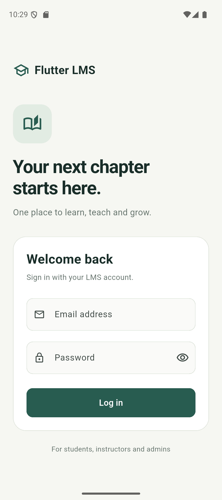

# Day 1 progress and fundamentals

Scope: Flutter setup, project initialization and the initial shared login UI. GitHub is reserved for the developer to handle manually. No later-day application features are implemented.

## Completed implementation

- Created a separate Android Flutter LMS project, leaving `flutter_setup_test` intact.
- Created one login screen for Student, Instructor and Admin accounts.
- Added aligned email/password fields, a password visibility toggle and a login button.
- The login action shows a preview message; it never claims successful authentication.
- Kept the page scrollable for a smaller screen or open keyboard.
- Organized the authentication screen in a feature-based folder.
- Checked the existing Flutter, Dart, Android, Docker, Git and Postman installations.

## Flutter fundamentals

`main()` calls `runApp`, which installs the root widget. `pubspec.yaml` declares the project, Dart SDK requirement and dependencies. `android/` hosts the native Android launcher and Gradle build. `test/` holds automated checks. Generated `build/` and `.dart_tool/` directories are disposable outputs and should not be committed.

### Widget tree in this project

```text
LmsApp (StatelessWidget)
  MaterialApp
    LoginScreen (StatefulWidget)
      Scaffold
        SafeArea
          Center
            SingleChildScrollView
              ConstrainedBox
                Column
                  Row: school icon + app name
                  Container: book icon
                  Text: heading and subtitle
                  Container
                    Column: email, password, login button
                  Text: supported accounts
```

### StatelessWidget versus StatefulWidget

A StatelessWidget describes UI from its configuration and inherited values. It has no separate mutable State object, but it can still rebuild when its parent or inherited dependencies change. `LmsApp` is stateless because it describes the application shell.

A StatefulWidget has a separate State object for values that change during its lifetime. `LoginScreen` stores `_obscurePassword` in its State. Pressing the eye button calls `setState`, toggles that value and rebuilds the screen so the password becomes visible or hidden. Do not mutate fields on the widget itself.

### Layout practice

- `Row`: places the school icon and app name horizontally.
- `Column`: stacks the heading, inputs and button vertically.
- `Container`: provides background color, border and rounded corners for the login card.
- Padding: `EdgeInsets` adds space inside the scroll area and card.
- Margin: the book icon Container leaves space outside its bottom edge.
- `SizedBox`: creates explicit gaps between widgets.
- Alignment: `Align` places the book icon at the left; `Center` positions the content; `crossAxisAlignment.stretch` gives fields consistent widths.
- `Flexible`: lets the app name wrap on narrow displays or with larger text.

Try changing one SizedBox height, the card padding and the Row alignment, then hot reload and explain the visual difference. Restore the values afterward.

## Verification

- `flutter doctor -v`: Android toolchain passes; licenses accepted. Windows Visual Studio components are unrelated to this Android target.
- `flutter analyze`: no issues found.
- `flutter test --concurrency=1`: both checks passed (password visibility/preview submission and small screen with keyboard).
- Android build: BUILD SUCCESSFUL using the installed CMake 4.1.2 and reduced-memory configuration. APK installed successfully; the LMS MainActivity is the resumed Android activity. Runtime log check returned no Flutter or AndroidRuntime errors. Screenshot saved at `evidence/day-one-login.png`. Both UI tests passed again after the Android build finished.

## Setup issues investigated

The initial template allowed an 8 GB Java heap plus 4 GB metaspace, which is excessive alongside this machine's emulator and other apps. Build limits were reduced and worker counts constrained. A separate Java loopback failure was avoided with a project-local TEMP/TMP directory; the launcher helper applies this only while running the app.

No global Flutter, Android, Windows, Docker or emulator configuration was changed. Raw startup/crash logs are ignored by Git and are not required for handoff.

The Android app explicitly selects the installed SDK CMake 4.1.2, avoiding a stalled automatic download of the default 3.22.1. This is project build configuration only.


## Emulator evidence




A final attempt through the normal Flutter launcher again exceeded system memory. The app itself built and launched successfully through direct Gradle plus ADB. The provided helper uses that verified route with one worker and no persistent Gradle daemon. The script targets the configured Android x64 emulator. Close unneeded applications before hot-reload development; tests should run separately from builds.

